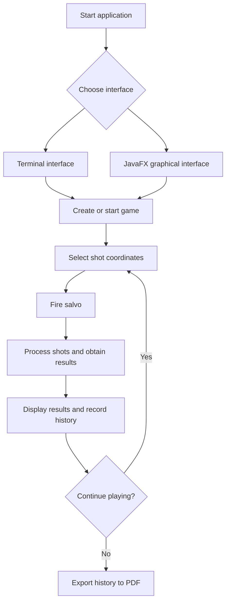

# ⚓ Battleship 2.0


> A Java implementation of the classic Battleship game, set in the age of the Portuguese Discoveries. Developed as a Software Engineering project at ISCTE-IUL, featuring a terminal interface, a JavaFX graphical interface, and PDF game-history export.

**Grupo:** GrupoTp03_LEI-PL-10

| Número | Nome | Curso |
|---:|---|---|
| 83590 | Valentyna Rusinova | Engenharia Informática (PL) |
| 105447 | Rodrigo Silva | Engenharia Informática (PL) |
| 128782 | João Mota | Engenharia Informática (PL) |
| 128791 | João Nunes | Engenharia Informática (PL) |

---

## 📖 Table of Contents

- [Project Overview](#-project-overview)
- [Key Features](#-key-features)
- [Student Contributions](#-student-contributions)
- [AI Opponent (LLM)](#-ai-opponent-llm)
- [Youtube video showcase](#-youtube-showcase)
- [Technical Stack](#-technical-stack)
- [Installation & Setup](#-installation--setup)
- [Code Architecture](#-code-architecture)
- [Documentation](#-documentation)
- [Roadmap](#-roadmap)
- [Testing](#-testing)
- [Contributing](#-contributing)
- [License](#-license)

---

## 🎯 Project Overview

Battleship 2.0 is a Java implementation of the classic naval warfare game, using ships associated with the Portuguese age of the Discoveries.

The project combines object-oriented programming, automated build management with Maven, a terminal user interface, a JavaFX graphical interface, and a REST server used for communication between the GUI and the game.

### 🎮 The Rules

The game is played on a 10 × 10 grid, with rows identified by letters A–J and columns numbered 1–10.

Each fleet consists of 11 ships:

- **4 Barges:** 1 grid position each.
- **3 Caravels:** 2 grid positions each.
- **2 Carracks:** 3 grid positions each.
- **1 Frigate:** 4 grid positions.
- **1 Galleon:** 5 grid positions arranged in a T shape.

Ships may be placed in different orientations, including the permitted orientations of the Galleon. They must not touch one another, even diagonally.

During the game, players fire salvos at selected coordinates. The game reports whether shots hit or miss, whether ships are sunk, and whether shots are invalid or repeated. The game ends when all ships in the target fleet have been sunk.

---

## ✨ Key Features

| Feature | Description | Status |
|---|---|:---:|
| **Grid System** | 10 × 10 board with labelled rows and numbered columns. | ✅ |
| **Ship Varieties** | Barges, Caravels, Carracks, Frigates and Galleons. | ✅ |
| **Terminal Interface (TUI)** | Generate fleets, inspect the board, fire salvos, view shots and simulate games through terminal commands. | ✅ |
| **Graphical Interface (GUI)** | JavaFX interface with two boards, interactive shot selection, game controls and results display. | ✅ |
| **Game Simulation** | Simulate a game using the terminal command `simula` or the corresponding GUI functionality. | ✅ |
| **PDF Game-History Export** | Export recorded moves, shot coordinates and outcomes to a PDF report. The TUI supports the `exportapdf` command; end-to-end GUI validation is pending. | 🚧 |
| **Turn Timer** | The graphical interface shows the elapsed time of the current turn and the duration of the last turn. | ✅ |
| **Internationalisation** | The game messages exist in Portuguese and English (`pt`/`en`), chosen when the terminal interface starts and used by the GUI. | ✅ |
| **AI Opponent (LLM)** | An LLM plays against the game by exchanging JSON volleys; the final strategy prompt is documented below. | ✅ |
| **REST API** | Spring Boot server used for communication between the graphical client and the game. | ✅ |
| **AI Shot Strategy** | AI shot-selection functionality provided by the server-side strategy component. | ✅ |

---

## 👥 Student Contributions

The project has been extended through student-developed enhancements tracked with GitHub Issues.

### 1. Graphical Interface — [Issue #1](https://github.com/LEI-128791/Battleship2/issues/1)

The original game relied on terminal interaction. This enhancement introduced a JavaFX graphical interface to make playing and observing the game more intuitive.

The functionality includes:

- Visual representation of the player's and opponent's boards.
- Interactive selection of positions for firing shots.
- Display of shot results and the current game state.
- Game controls, including starting a new game, firing salvos and simulating gameplay.

The graphical interface communicates with the game server and presents the results of its responses without replacing the underlying game rules.

### 2. Export Game History to PDF — [Issue #3](https://github.com/LEI-128791/Battleship2/issues/3)

This enhancement allows players to save a game's move history as a PDF document for later review.

The implementation uses **Apache PDFBox**, a Java library for creating PDF documents.

The report includes:

- Sequential move numbers.
- Shot coordinates.
- The corresponding outcomes, such as water, a ship hit or a sunk ship.
- Multiple pages when the history is too long for one page.

The TUI provides the `exportapdf` command to generate the report. The exporter also selects a numbered filename when the requested filename already exists, helping prevent previous reports from being overwritten.

The graphical interface includes an export workflow with a file chooser; its end-to-end behaviour is still being validated.

The export functionality is implemented in a shared `PdfReportExporter` class, allowing both interfaces to reuse the same PDF-generation logic.

### 3. Turn Timer — [Issue #5](https://github.com/LEI-128791/Battleship2/issues/5)

The graphical interface now shows two extra statistics next to the shots, hits and accuracy: the **turn time** (a `mm:ss` clock for the current turn) and the **last turn** (how long the previous turn took, in seconds). The timer uses `commons-lang3`.

### 4. Internationalisation — [Issue #7](https://github.com/LEI-128791/Battleship2/issues/7)

All the texts of the terminal and graphical interfaces were moved out of the code into `messages_pt.properties` and `messages_en.properties`, read by the `Messages` class. The terminal interface asks for the language (`pt`/`en`) when it starts.

### 5. AI Opponent (LLM)

An LLM can play against the game by sending volleys and receiving the results as JSON. The strategy prompt and its results are in [AI Opponent (LLM)](#-ai-opponent-llm).

---

## 🤖 AI Opponent (LLM)

We trained an LLM to play Battleship against our program using **few-shot prompting**, exchanging the volleys and the results as JSON (copy & paste between the chat and the console). The prompts were tested with Gemini, ChatGPT, Claude Haiku and Claude Sonnet.

### Final strategy prompt

This is the strategy prompt we ended up with. With it, the LLM sank the whole fleet in **22 volleys (Claude Sonnet)** and **25 volleys (Claude Haiku)**; the first versions needed 31–34 and had no upper limit: a game against an LLM that forgets hit ships or repeats shots can go well beyond 34 volleys (two of our tests had not finished after 33).

The base game already detects repeated shots (it counts them in `repeatedShots` and they give no information), but nothing stopped the LLM from firing at the same cell again, and every repeated shot is a wasted shot that makes the game longer. In the first tests it did so in several volleys. The final prompt tells it to fire only at cells that are still free, which removed this problem in the Sonnet game (no repeated shot) and reduced it in the others.

```text
Agora vamos jogar a sério. Siga este método em TODAS as respostas, sem saltar passos.

== O QUE RECEBE ==
Depois de cada rajada recebe: o JSON, o Diário de Bordo (todas as rajadas), os Tiros já disparados
e as Casas livres. O JSON diz QUANTOS tiros acertaram em cada tipo de navio. NÃO diz QUAL tiro.

== NAVIOS ==
Barca 1 casa (há 4) · Caravela 2 (há 3) · Nau 3 (há 2) · Fragata 4 (há 1) · Galeão 5 (há 1).
Caravela, Nau e Fragata: casas seguidas em linha reta.
Galeão: um T de 5 casas = uma barra de 3 casas + uma haste de 2 casas que sai do MEIO da barra.
As 4 formas, com coordenadas de exemplo:
  Norte: C3 C4 C5 + D4 E4      Sul:   E2 E3 E4 + C3 D3
  Este:  C3 D3 E3 + D1 D2      Oeste: C3 D3 E3 + D4 D5
Teste do Galeão: tem 3 casas numa linha e 3 numa coluna, que se cruzam no MEIO da barra.
Se se cruzam na ponta da barra, é um L, e um L não é um Galeão.
Os navios nunca se tocam, nem na diagonal.

== FORMATO DA RESPOSTA (sempre as 2 partes) ==
PARTE 1 - FICHA (copie a da sua resposta anterior e mude só o que o JSON novo trouxe)
Faltam: Galeão 1 | Fragata 1 | Nau 2 | Caravela 3 | Barca 4
Acertos por resolver: Galeão 0 | Fragata 0 | Nau 0 | Caravela 0
Alvos: nenhum
Água certa: nenhuma
PARTE 2 - RAJADA
Um tiro por linha, com o caso e a razão. No fim, o JSON e o comando:
{ [ {"row": "H", "column": 7}, {"row": "H", "column": 9}, {"row": "G", "column": 8} ] }
rajada H7 H9 G8

== PASSO A: ATUALIZAR A FICHA ==
A1. Há {"hits": n, "type": T}: some n em Acertos por resolver de T.
    SE a rajada era um TESTE de um alvo T: o candidato testado passa a "certa" e os 3 tiros a
    "pontas"; apague os outros candidatos.
    SE a rajada era uma CAÇA de um alvo T: os tiros dessa caça passam a ser as "pontas".
    SENÃO: crie um alvo "T | candidatos: <os 3 tiros> | já testados: nenhum".
A2. Há {"type": T} em sunkBoats: Faltam de T menos 1; Acertos por resolver de T menos
    (tamanho de T - 1); apague o alvo T; aplique a REGRA DO HALO.
A3. A rajada era para um alvo e não acertou nem afundou esse tipo: num TESTE, o candidato vai
    para "já testados"; numa CAÇA, apague as pontas.
A4. SE Acertos por resolver de T é maior que 0 e não há alvo T, esqueceu um alvo: procure no
    Diário a rajada com esse acerto e crie o alvo com os 3 tiros dela.

== REGRA DO HALO (quando um navio vai ao fundo) ==
1. Junte a casa certa dele (num TESTE, o candidato testado) e todos os tiros das rajadas do
   Diário onde esse tipo foi atingido ou afundou.
2. Escreva as posições possíveis do navio só com essas casas (forma e tamanho certos).
3. As casas ainda por disparar que tocam (mesmo na diagonal) em TODAS essas posições passam a
   Água certa.
4. Em dúvida, não marque. Uma Barca afundada numa PROCURA não tem halo.

== PASSO B: ESCOLHER OS 3 TIROS (o primeiro caso que serve) ==
CASO 1 - CAÇA (há um alvo com "certa"): dispare na casa a seguir a cada ponta, em linha reta a
   partir da certa (certa H8 e ponta H9 -> H10). Sem pontas: os vizinhos livres da certa (Norte,
   Sul, Este, Oeste). Galeão sem casas a seguir: os vizinhos livres das pontas e da certa que
   completam uma das 4 formas do Galeão.
CASO 2 - TESTE (há um alvo só com candidatos): escolha o candidato não testado onde o navio cabe
   de mais maneiras (mais casas livres seguidas à volta). Dispare em 3 vizinhos dele, os do lado
   com mais espaço. Nunca dê um candidato como certo sem um TESTE com acerto.
CASO 3 - PROCURA (não há alvos): escolha a Casa livre com mais casas livres seguidas na sua linha
   e na sua coluna (conte até 4 para cada lado). Em empate, a da zona mais vazia. Fique longe dos
   alvos. Os tiros de procura não podem tocar uns nos outros.
REGRA DAS BARCAS - quando em Faltam só houver Barcas: escreva uma vez a lista das casas possíveis
   (Casas livres que não são Água certa e não tocam, nem na diagonal, em nenhum navio afundado).
   Dispare só nessas casas. As Barcas podem estar a 2 casas de um navio, mas nunca encostadas.
VERIFICAÇÃO - antes de enviar, escreva para cada tiro qual é o navio afundado mais perto e confirme
   que o tiro não toca nele (nem na diagonal). Se tocar, troque o tiro.
Se o caso não der 3 tiros, complete com PROCURA.
Os 3 tiros têm de ser diferentes, estar nas Casas livres e estar fora da Água certa.
Há sempre Casas livres: nunca diga que não consegue jogar. Só se houver menos de 3 Casas livres
pode repetir uma casa.

== EXEMPLO 1: TESTE ==
Recebe: 1 tiro numa Nau na rajada H8 E3 C9.
PARTE 1 - FICHA
Faltam: Galeão 1 | Fragata 1 | Nau 2 | Caravela 3 | Barca 4
Acertos por resolver: Galeão 0 | Fragata 0 | Nau 1 | Caravela 0
Alvos: Nau | candidatos: H8 E3 C9 | já testados: nenhum
Água certa: nenhuma
PARTE 2 - RAJADA
H7 - CASO 2, TESTE de H8 (H8 e E3 têm mais espaço do que C9, junto à margem)
H9 - CASO 2, TESTE de H8
G8 - CASO 2, TESTE de H8
{ [ {"row": "H", "column": 7}, {"row": "H", "column": 9}, {"row": "G", "column": 8} ] }
rajada H7 H9 G8
Se a resposta seguinte tiver 1 tiro na Nau: "Nau | certa: H8 | pontas: H7 H9 G8" e CAÇA H6 H10 F8.
Se não tiver: "já testados: H8" e TESTE de E3.

== EXEMPLO 2: REGRA DO HALO ==
Diário: R1 F5 A1 J9 = 1 tiro numa Caravela. R2 (TESTE de F5) F4 F6 E5 = 1 Caravela ao fundo.
Posições possíveis com F5 e os tiros de R1 e R2: F4-F5, F5-F6, E5-F5.
Casas por disparar que tocam nas três: E4, E6, G4, G5, G6 -> Água certa: E4 E6 G4 G5 G6.

== EXEMPLO 3: ALVO ESQUECIDO (A4) ==
FICHA com "Acertos por resolver: Nau 2" e "Alvos: nenhum". No Diário: R27 H5 H6 E4 = 1 tiro numa
Nau; R29 D5 G4 G6 = 1 tiro numa Nau. Crie os 2 alvos:
Alvos: Nau | candidatos: H5 H6 E4 | já testados: nenhum
       Nau | candidatos: D5 G4 G6 | já testados: nenhum

Se a sua frota for toda afundada, declare a derrota com honra. Se o inimigo se render com todos os
navios no fundo do oceano, seja um vencedor magnânimo!
```
Everything else lives in the [`83590-test-LLM` branch](https://github.com/LEI-128791/Battleship2/tree/83590-test-LLM/Battleship2-main):

- the other prompts, in the order they are sent (rules, Galleon shapes, JSON protocol): [`PROMPTS_GEMINI.md`](https://github.com/LEI-128791/Battleship2/blob/83590-test-LLM/Battleship2-main/PROMPTS_GEMINI.md);
- why the prompt is written this way, the test results and the correction messages: [`PROMPT_ESTRATEGIA.md`](https://github.com/LEI-128791/Battleship2/blob/83590-test-LLM/Battleship2-main/PROMPT_ESTRATEGIA.md);
- the changes to the program that make the game practical to play (accepting the LLM's JSON in `rajada` and printing the line to paste into the chat, with the logbook and the free cells that this prompt relies on).

> **Note:** to play against an LLM, use the branch. In `main` the keys and ship names of the JSON answer follow the interface language (for example `tirosValidos` in Portuguese), which are not the ones of the protocol the LLM was taught. The branch always answers with the protocol's keys (`validShots`, `sunkBoats`, …).

---
## ▶ Youtube showcase
<https://youtu.be/iqsdS-GefiI>
---

## 🛠 Technical Stack

- **Language:** Java 21 or higher.
- **Build Tool:** Apache Maven.
- **Graphical Interface:** JavaFX.
- **Server:** Spring Boot and REST API.
- **PDF Generation:** Apache PDFBox.
- **JSON Processing:** Jackson.
- **Testing:** JUnit 5.
- **Logging:** Log4j2.
- **Version Control and Collaboration:** Git and GitHub.

Maven manages project dependencies, including the libraries required by the graphical interface, server and PDF exporter.

---

## 🚀 Installation & Setup

### Prerequisites

- JDK 21 or higher.
- Git.
- Apache Maven, or IntelliJ IDEA with its bundled Maven installation.

### Step-by-Step

**1. Clone the repository**

```bash
git clone https://github.com/LEI-128791/Battleship2.git
```

**2. Navigate to the Maven project**

```bash
cd Battleship2/Battleship2-main
```

**3. Compile the project and run the tests**

```bash
mvn test
```

**4. Run the terminal interface**

Open the project in IntelliJ IDEA and run the `main()` method in `battleship.Main`.

**5. Run the graphical interface**

Start the `main()` method in `restserver.BattleshipServer` and leave the server running. Then launch the JavaFX application using the Maven plugin:

```bash
mvn javafx:run
```

The graphical client uses the REST server to communicate with the game. Make sure the server is running before starting a GUI game.

---

## 🧱 Code Architecture

The project is organised into packages with different responsibilities.

### Core Components

| Component | Responsibility |
|---|---|
| `battleship` | Core game logic, ship and fleet management, positions, moves, and the terminal interface. |
| `gui` | JavaFX boards, graphical controls, the client-server communication layer and GUI event handling. |
| `restserver` | REST endpoints, game sessions, request/response data structures and AI shot strategy. |
| `PdfReportExporter` | Shared PDF generation logic using Apache PDFBox. |

The PDF exporter is separated from the user interfaces. The TUI and GUI can prepare the move history and pass it to the same exporter, avoiding duplicated PDF-generation code.

### Design Patterns and Design Principles

- **Separation of concerns:** the game rules, graphical presentation, server communication and PDF generation are handled by separate components.
- **Interface-based design:** the core game model uses interfaces such as `IGame` and `IMove`.
- **Callback-based interaction:** JavaFX controls invoke controller actions when users interact with the GUI.

### Logic Flow



---

## 📚 Documentation

The project includes Javadoc documentation in the [`docs/`](../docs/) directory.

The documentation describes the project's classes, methods and interfaces, providing a reference for understanding and extending the implementation.

---

## 🗺 Roadmap

Potential future improvements include:

- [ ] Sound effects and additional game feedback.
- [ ] Further development of AI shot-selection strategies.
- [ ] Additional gameplay and multiplayer capabilities.

---

## 🧪 Testing

The project uses JUnit 5 to test the core game logic.

Run the test suite using Maven:

```bash
mvn test
```

Maven compiles the project, resolves the required dependencies and runs the configured tests.

---

## 🤝 Contributing

Contributions are developed using Git branches and tracked through GitHub Issues.

1. Identify or create an Issue describing the proposed enhancement.
2. Create a feature branch associated with that Issue.
3. Implement the change and commit it with a descriptive message referencing the Issue.
4. Run the appropriate checks.
5. Push the branch to GitHub.
6. Open a Pull Request referencing the corresponding Issue.
7. Ask another team member to review the changes before merging.

Example commit message:

```text
Refs #3: Improve PDF report generation
```

This workflow helps maintain traceability between requirements, implementation and review.

---

## 📄 License
Distributed under the MIT License. See `LICENSE` for more information.

---
**Maintained by:** [@britoeabreu](https://github.com/britoeabreu)  
*Created for the Software Engineering students at ISCTE-IUL.*
