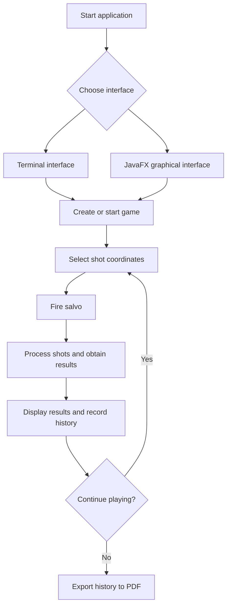

# ⚓ Battleship 2.0


> A Java implementation of the classic Battleship game, set in the age of the Portuguese Discoveries. Developed as a Software Engineering project at ISCTE-IUL, featuring a terminal interface, a JavaFX graphical interface, and PDF game-history export.

| Número | Nome | Curso |
|---:|---|---|
| 83590 | Valentyna Rusinova | Engenharia Informática (PL) |
| 105447 | Rodrigo Silva | Engenharia Informática (PL) |
| 128782 | João Mota | Engenharia Informática (PL) |
| 128791 | João Nunes | Engenharia Informática (PL) |

---

## 📖 Table of Contents

- [Project Overview](#-project-overview)
- [Key Features](#-key-features)
- [Student Contributions](#-student-contributions)
- [Technical Stack](#-technical-stack)
- [Installation & Setup](#-installation--setup)
- [Code Architecture](#-code-architecture)
- [Roadmap](#-roadmap)
- [Contributing](#-contributing)
- [License](#-license)

---

## 🎯 Project Overview

Battleship 2.0 is a Java implementation of the classic naval warfare game, using ships associated with the Portuguese age of the Discoveries.

The project combines object-oriented programming, automated build management with Maven, a terminal user interface, a JavaFX graphical interface, and a REST server used for communication between the GUI and the game.

### 🎮 The Rules

The game is played on a 10 × 10 grid, with rows identified by letters A–J and columns numbered 1–10.

Each fleet consists of 11 ships:

- **4 Barges:** 1 grid position each.
- **3 Caravels:** 2 grid positions each.
- **2 Carracks:** 3 grid positions each.
- **1 Frigate:** 4 grid positions.
- **1 Galleon:** 5 grid positions arranged in a T shape.

Ships may be placed in different orientations, including the permitted orientations of the Galleon. They must not touch one another, even diagonally.

During the game, players fire salvos at selected coordinates. The game reports whether shots hit or miss, whether ships are sunk, and whether shots are invalid or repeated. The game ends when all ships in the target fleet have been sunk.

---

## ✨ Key Features

| Feature | Description | Status |
|---|---|:---:|
| **Grid System** | 10 × 10 board with labelled rows and numbered columns. | ✅ |
| **Ship Varieties** | Barges, Caravels, Carracks, Frigates and Galleons. | ✅ |
| **Terminal Interface (TUI)** | Generate fleets, inspect the board, fire salvos, view shots and simulate games through terminal commands. | ✅ |
| **Graphical Interface (GUI)** | JavaFX interface with two boards, interactive shot selection, game controls and results display. | ✅ |
| **Game Simulation** | Simulate a game using the terminal command `simula` or the corresponding GUI functionality. | ✅ |
| **PDF Game-History Export** | Export recorded moves, shot coordinates and outcomes to a PDF report. The TUI supports the `exportapdf` command; end-to-end GUI validation is pending. | 🚧 |
| **REST API** | Spring Boot server used for communication between the graphical client and the game. | ✅ |
| **AI Shot Strategy** | AI shot-selection functionality provided by the server-side strategy component. | ✅ |

---

## 👥 Student Contributions

The project has been extended through student-developed enhancements tracked with GitHub Issues.

### 1. Graphical Interface — [Issue #1](https://github.com/LEI-128791/Battleship2/issues/1)

The original game relied on terminal interaction. This enhancement introduced a JavaFX graphical interface to make playing and observing the game more intuitive.

The functionality includes:

- Visual representation of the player's and opponent's boards.
- Interactive selection of positions for firing shots.
- Display of shot results and the current game state.
- Game controls, including starting a new game, firing salvos and simulating gameplay.

The graphical interface communicates with the game server and presents the results of its responses without replacing the underlying game rules.

### 2. Export Game History to PDF — [Issue #3](https://github.com/LEI-128791/Battleship2/issues/3)

This enhancement allows players to save a game's move history as a PDF document for later review.

The implementation uses **Apache PDFBox**, a Java library for creating PDF documents.

The report includes:

- Sequential move numbers.
- Shot coordinates.
- The corresponding outcomes, such as water, a ship hit or a sunk ship.
- Multiple pages when the history is too long for one page.

The TUI provides the `exportapdf` command to generate the report. The exporter also selects a numbered filename when the requested filename already exists, helping prevent previous reports from being overwritten.

The graphical interface includes an export workflow with a file chooser; its end-to-end behaviour is still being validated.

The export functionality is implemented in a shared `PdfReportExporter` class, allowing both interfaces to reuse the same PDF-generation logic.

---

## 🛠 Technical Stack

- **Language:** Java 21 or higher.
- **Build Tool:** Apache Maven.
- **Graphical Interface:** JavaFX.
- **Server:** Spring Boot and REST API.
- **PDF Generation:** Apache PDFBox.
- **JSON Processing:** Jackson.
- **Testing:** JUnit 5.
- **Logging:** Log4j2.
- **Version Control and Collaboration:** Git and GitHub.

Maven manages project dependencies, including the libraries required by the graphical interface, server and PDF exporter.

---

## 🚀 Installation & Setup

### Prerequisites

- JDK 21 or higher.
- Git.
- Apache Maven, or IntelliJ IDEA with its bundled Maven installation.

### Step-by-Step

**1. Clone the repository**

```bash
git clone https://github.com/LEI-128791/Battleship2.git
```

**2. Navigate to the Maven project**

```bash
cd Battleship2/Battleship2-main
```

**3. Compile the project and run the tests**

```bash
mvn test
```

**4. Run the terminal interface**

Open the project in IntelliJ IDEA and run the `main()` method in `battleship.Main`.

**5. Run the graphical interface**

Start the `main()` method in `restserver.BattleshipServer` and leave the server running. Then launch the JavaFX application using the Maven plugin:

```bash
mvn javafx:run
```

The graphical client uses the REST server to communicate with the game. Make sure the server is running before starting a GUI game.

---

## 🧱 Code Architecture

The project is organised into packages with different responsibilities.

### Core Components

| Component | Responsibility |
|---|---|
| `battleship` | Core game logic, ship and fleet management, positions, moves, and the terminal interface. |
| `gui` | JavaFX boards, graphical controls, the client-server communication layer and GUI event handling. |
| `restserver` | REST endpoints, game sessions, request/response data structures and AI shot strategy. |
| `PdfReportExporter` | Shared PDF generation logic using Apache PDFBox. |

The PDF exporter is separated from the user interfaces. The TUI and GUI can prepare the move history and pass it to the same exporter, avoiding duplicated PDF-generation code.

### Design Patterns and Design Principles

- **Separation of concerns:** the game rules, graphical presentation, server communication and PDF generation are handled by separate components.
- **Interface-based design:** the core game model uses interfaces such as `IGame` and `IMove`.
- **Callback-based interaction:** JavaFX controls invoke controller actions when users interact with the GUI.

### Logic Flow



---

## 📚 Documentation

The project includes Javadoc documentation in the [`docs/`](docs/) directory.

The documentation describes the project's classes, methods and interfaces, providing a reference for understanding and extending the implementation.

---

## 🗺 Roadmap

Potential future improvements include:

- [ ] Sound effects and additional game feedback.
- [ ] Further development of AI shot-selection strategies.
- [ ] Additional gameplay and multiplayer capabilities.

---

## 🧪 Testing

The project uses JUnit 5 to test the core game logic.

Run the test suite using Maven:

```bash
mvn test
```

Maven compiles the project, resolves the required dependencies and runs the configured tests.

---

## 🤝 Contributing

Contributions are developed using Git branches and tracked through GitHub Issues.

1. Identify or create an Issue describing the proposed enhancement.
2. Create a feature branch associated with that Issue.
3. Implement the change and commit it with a descriptive message referencing the Issue.
4. Run the appropriate checks.
5. Push the branch to GitHub.
6. Open a Pull Request referencing the corresponding Issue.
7. Ask another team member to review the changes before merging.

Example commit message:

```text
Refs #3: Improve PDF report generation
```

This workflow helps maintain traceability between requirements, implementation and review.

---

## 📄 License
Distributed under the MIT License. See `LICENSE` for more information.

---
**Maintained by:** [@britoeabreu](https://github.com/britoeabreu)  
*Created for the Software Engineering students at ISCTE-IUL.*
