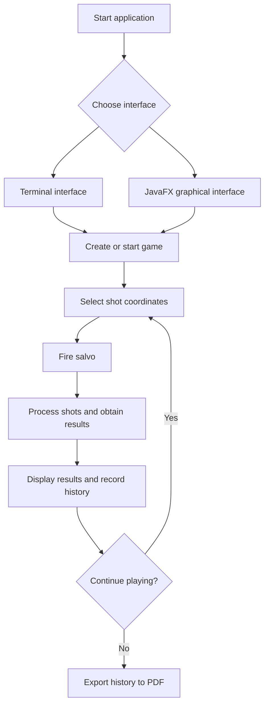

# ⚓ Battleship 2.0


> A Java implementation of the classic Battleship game, set in the age of the Portuguese Discoveries. Developed as a Software Engineering project at ISCTE-IUL, featuring a terminal interface, a JavaFX graphical interface, and PDF game-history export.

| Número | Nome | Curso |
|---:|---|---|
| 83590 | Valentyna Rusinova | Engenharia Informática (PL) |
| 105447 | Rodrigo Silva | Engenharia Informática (PL) |
| 128782 | João Mota | Engenharia Informática (PL) |
| 128791 | João Nunes | Engenharia Informática (PL) |

---

## 📖 Table of Contents

- [Project Overview](#-project-overview)
- [Key Features](#-key-features)
- [Student Contributions](#-student-contributions)
- [AI Opponent (LLM)](#-ai-opponent-llm)
- [Youtube video showcase](#-Youtube-showcase)
- [Technical Stack](#-technical-stack)
- [Installation & Setup](#-installation--setup)
- [Code Architecture](#-code-architecture)
- [Roadmap](#-roadmap)
- [Contributing](#-contributing)
- [License](#-license)

---

## 🎯 Project Overview

Battleship 2.0 is a Java implementation of the classic naval warfare game, using ships associated with the Portuguese age of the Discoveries.

The project combines object-oriented programming, automated build management with Maven, a terminal user interface, a JavaFX graphical interface, and a REST server used for communication between the GUI and the game.

### 🎮 The Rules

The game is played on a 10 × 10 grid, with rows identified by letters A–J and columns numbered 1–10.

Each fleet consists of 11 ships:

- **4 Barges:** 1 grid position each.
- **3 Caravels:** 2 grid positions each.
- **2 Carracks:** 3 grid positions each.
- **1 Frigate:** 4 grid positions.
- **1 Galleon:** 5 grid positions arranged in a T shape.

Ships may be placed in different orientations, including the permitted orientations of the Galleon. They must not touch one another, even diagonally.

During the game, players fire salvos at selected coordinates. The game reports whether shots hit or miss, whether ships are sunk, and whether shots are invalid or repeated. The game ends when all ships in the target fleet have been sunk.

---

## ✨ Key Features

| Feature | Description | Status |
|---|---|:---:|
| **Grid System** | 10 × 10 board with labelled rows and numbered columns. | ✅ |
| **Ship Varieties** | Barges, Caravels, Carracks, Frigates and Galleons. | ✅ |
| **Terminal Interface (TUI)** | Generate fleets, inspect the board, fire salvos, view shots and simulate games through terminal commands. | ✅ |
| **Graphical Interface (GUI)** | JavaFX interface with two boards, interactive shot selection, game controls and results display. | ✅ |
| **Game Simulation** | Simulate a game using the terminal command `simula` or the corresponding GUI functionality. | ✅ |
| **PDF Game-History Export** | Export recorded moves, shot coordinates and outcomes to a PDF report. The TUI supports the `exportapdf` command; end-to-end GUI validation is pending. | 🚧 |
| **REST API** | Spring Boot server used for communication between the graphical client and the game. | ✅ |
| **AI Shot Strategy** | AI shot-selection functionality provided by the server-side strategy component. | ✅ |

---

## 👥 Student Contributions

The project has been extended through student-developed enhancements tracked with GitHub Issues.

### 1. Graphical Interface — [Issue #1](https://github.com/LEI-128791/Battleship2/issues/1)

The original game relied on terminal interaction. This enhancement introduced a JavaFX graphical interface to make playing and observing the game more intuitive.

The functionality includes:

- Visual representation of the player's and opponent's boards.
- Interactive selection of positions for firing shots.
- Display of shot results and the current game state.
- Game controls, including starting a new game, firing salvos and simulating gameplay.

The graphical interface communicates with the game server and presents the results of its responses without replacing the underlying game rules.

### 2. Export Game History to PDF — [Issue #3](https://github.com/LEI-128791/Battleship2/issues/3)

This enhancement allows players to save a game's move history as a PDF document for later review.

The implementation uses **Apache PDFBox**, a Java library for creating PDF documents.

The report includes:

- Sequential move numbers.
- Shot coordinates.
- The corresponding outcomes, such as water, a ship hit or a sunk ship.
- Multiple pages when the history is too long for one page.

The TUI provides the `exportapdf` command to generate the report. The exporter also selects a numbered filename when the requested filename already exists, helping prevent previous reports from being overwritten.

The graphical interface includes an export workflow with a file chooser; its end-to-end behaviour is still being validated.

The export functionality is implemented in a shared `PdfReportExporter` class, allowing both interfaces to reuse the same PDF-generation logic.

---

## 🤖 AI Opponent (LLM)

We trained an LLM (Gemini Pro) to play Battleship against our program using **few-shot prompting**. Shots and results are exchanged as JSON (copy & paste between the LLM and the console).

### Communication protocol

The `rajada` / `fire` command accepts a volley in the LLM's JSON format. It may span several lines, be pasted on the line after the command, or come inside a ```json code block, as chats usually return it:

```json
{
[ {"row": "A", "column": 5},
  {"row": "C", "column": 10},
  {"row": "F", "column" : 5} ]
}
```

The program answers with the JSON produced by `Move.processEnemyFire`. It always uses the protocol's keys and ship names, whatever the interface language:

```json
{
  "validShots" : 3,
  "sunkBoats" : [ { "count" : 1, "type" : "Barca" } ],
  "repeatedShots" : 0,
  "outsideShots" : 0,
  "hitsOnBoats" : [ { "hits" : 1, "type" : "Nau" } ],
  "missedShots" : 1
}
```

### Final strategy prompt

Designed so that weaker models also play well, and tested against the same fixed fleets (loaded with `lefrota`) so luck does not hide the differences. Every answer must have 3 parts (state sheet, written check of each shot, JSON volley), shown in a full example. Searching follows a precomputed list. Hunting uses one rule taken from a simulator of a perfect player: list every possible position of each hit ship and fire at the cells that appear in the most positions. Every volley still has exactly 3 shots. Results on the same fleets: Claude Haiku averaged **22.7 volleys** (22, 23, 23), against 25.3 with the previous version; Claude Opus needed **22** on fleet 2 (27 before). A simulated perfect player needs about 21–22 on these fleets. See [JOGO_CONTRA_LLM.md](JOGO_CONTRA_LLM.md).

**Copy & paste tip:** after each `rajada`, the program also prints a single line to paste into the chat: the JSON response, the list of every shot the LLM has already fired (grouped by row) and a short reminder of the answer format. It only repeats the LLM's own shots, so it gives away nothing about the fleet, but it means the LLM never has to remember them.

```text
Considere agora a seguinte tática de geração de rajadas de tiros. Objetivo: afundar os
11 navios inimigos (25 casas) no menor número de rajadas. Cada rajada tem SEMPRE 3 tiros.

########## FORMATO OBRIGATÓRIO DE CADA RESPOSTA (3 partes, sempre, sem exceções) ##########
1) FICHA
   Tiros: copie a lista "Tiros já disparados" que vem com cada resposta do inimigo.
   Mapa:  10 linhas (A a J) x 10 colunas, com X = acerto, ? = acerto possível,
          # = navio afundado, ~ = água, . = desconhecido.
   Faltam: navios ainda por afundar.
   Hipóteses: posições possíveis dos navios atingidos ou afundados que ainda são dúvida.
2) VERIFICAÇÃO — uma linha por tiro: "C5: dentro do mapa SIM | não está nos Tiros SIM | não é ~ SIM"
3) RAJADA — só o JSON, no fim:
   { [ {"row": "C", "column": 5}, {"row": "F", "column": 2}, {"row": "I", "column": 7} ] }
Uma resposta sem as 3 partes está errada. Se um tiro falhar a VERIFICAÇÃO, troque-o.

########## NAVIOS ##########
Barca 1 · Caravela 2 · Nau 3 (x2) · Fragata 4 · Galeão 5. Caravelas, Naus e Fragata são linhas
retas (horizontal ou vertical). O Galeão só tem estas 4 formas (# = navio):
  Norte    Sul      Este     Oeste
  # # #    . # .    . . #    # . .
  . # .    . # .    # # #    # # #
  . # .    # # #    . . #    # . .
Os navios NUNCA se tocam, nem na diagonal: as 8 casas à volta de um navio são água.

########## LER A RESPOSTA ##########
a) Tiros que afundaram navios = validShots − missedShots − soma dos "hits"
   (é um número de TIROS: 2 tiros podem afundar 1 só navio).
b) "hitsOnBoats" com acerto e não sabe em que tiro? Marque "?" nos tiros dessa rajada que
   ainda podem ser esse navio.
c) "sunkBoats": navio afundado. Não o cace. Junte as casas dele, marque "#" e o halo "~".
   Se houver dúvida sobre onde estava, escreva as hipóteses e só marque "~" onde for água
   em TODAS. Uma Barca afundada não precisa de mais tiros.
d) Só marque "~" onde disparou e deu água, ou no halo de um navio afundado.
e) Confirme: nenhum navio pode ter mais acertos do que o seu tamanho. Se não bater certo,
   corrija as hipóteses antes de disparar.

########## ESCOLHER OS 3 TIROS ##########
CAÇA — se houver acertos (X ou ?) de navios ainda por afundar:
1. Em "Hipóteses", escreva TODAS as posições possíveis (casas exatas) de cada navio atingido.
   Uma posição só é possível se respeitar a forma e o tamanho do navio, os acertos, a água,
   o halo dos navios afundados e as contagens de TODAS as respostas anteriores.
2. Conte em quantas hipóteses aparece cada casa "." e dispare nas 3 casas que aparecem em
   MAIS hipóteses. Uma casa que aparece em todas completa o navio de certeza.
3. Se houver menos de 3 casas úteis, complete com a lista de PROCURA.
PROCURA — se não houver nenhum navio atingido por afundar: percorra a lista pela ordem,
saltando casas já disparadas, "~" ou ao lado de um "#":
   Fase 1: H8 E3 C9 | I3 B10 F10 | C5 J2 I7 | A3 A7 G5 | B6 F2 G9 | D4 D8 H4 | J6 B2 F6 | E7 G1 C1 | J10
   Fase 2: I9 G3 A5 | H2 D10 B4 | E9 I1 A9 | C7 H6 H10 | D6 D2 I5 | E1 E5 A1 | G7 B8 C3 | F4 F8 J4 | J8
   Fase 3 (só faltam Barcas): escreva as casas "." onde ainda pode haver uma Barca (sem tocar
   em nenhum navio, em nenhuma hipótese) e dispare nelas, começando pelas que não dependem
   de nenhuma dúvida.
ÚLTIMA RAJADA: se faltarem menos de 3 casas possíveis, os tiros que sobram podem ir para
casas "~" (é a única exceção permitida).

########## EXEMPLO DE UMA RESPOSTA COMPLETA ##########
(depois de: Rajada 1 = H8 E3 C9 → 1 acerto numa Nau, 2 água)
1) FICHA
   Tiros: [C: 9 | E: 3 | H: 8]
   Mapa:
     1 2 3 4 5 6 7 8 9 10
   A . . . . . . . . . .
   B . . . . . . . . . .
   C . . . . . . . . ? .
   D . . . . . . . . . .
   E . . ? . . . . . . .
   F . . . . . . . . . .
   G . . . . . . . . . .
   H . . . . . . . ? . .
   I . . . . . . . . . .
   J . . . . . . . . . .
   Faltam: Galeão, Fragata, Nau x2, Caravela x3, Barca x4
   Hipóteses: o acerto na Nau foi em H8, E3 ou C9. As posições possíveis da Nau passam
   por uma destas casas; as que aparecem em mais posições são os vizinhos H7, E4 e C8.
2) VERIFICAÇÃO
   H7: dentro do mapa SIM | não está nos Tiros SIM | não é ~ SIM
   E4: dentro do mapa SIM | não está nos Tiros SIM | não é ~ SIM
   C8: dentro do mapa SIM | não está nos Tiros SIM | não é ~ SIM
3) RAJADA
   { [ {"row": "H", "column": 7}, {"row": "E", "column": 4}, {"row": "C", "column": 8} ] }

Se a sua frota for toda afundada, declare a derrota com honra. Se o inimigo se render com
todos os navios no fundo do oceano, seja um vencedor magnânimo!
```

> Few-shot examples used to teach the protocol, and the exact prompts used to set up the game, are in the assignment statement (Sprint – Parte 2).

---

---
## ▶ Youtube showcase
https://youtu.be/nRFuIBMP_yg
---

## 🛠 Technical Stack

- **Language:** Java 21 or higher.
- **Build Tool:** Apache Maven.
- **Graphical Interface:** JavaFX.
- **Server:** Spring Boot and REST API.
- **PDF Generation:** Apache PDFBox.
- **JSON Processing:** Jackson.
- **Testing:** JUnit 5.
- **Logging:** Log4j2.
- **Version Control and Collaboration:** Git and GitHub.

Maven manages project dependencies, including the libraries required by the graphical interface, server and PDF exporter.

---

## 🚀 Installation & Setup

### Prerequisites

- JDK 21 or higher.
- Git.
- Apache Maven, or IntelliJ IDEA with its bundled Maven installation.

### Step-by-Step

**1. Clone the repository**

```bash
git clone https://github.com/LEI-128791/Battleship2.git
```

**2. Navigate to the Maven project**

```bash
cd Battleship2/Battleship2-main
```

**3. Compile the project and run the tests**

```bash
mvn test
```

**4. Run the terminal interface**

Open the project in IntelliJ IDEA and run the `main()` method in `battleship.Main`.

**5. Run the graphical interface**

Start the `main()` method in `restserver.BattleshipServer` and leave the server running. Then launch the JavaFX application using the Maven plugin:

```bash
mvn javafx:run
```

The graphical client uses the REST server to communicate with the game. Make sure the server is running before starting a GUI game.

---

## 🧱 Code Architecture

The project is organised into packages with different responsibilities.

### Core Components

| Component | Responsibility |
|---|---|
| `battleship` | Core game logic, ship and fleet management, positions, moves, and the terminal interface. |
| `gui` | JavaFX boards, graphical controls, the client-server communication layer and GUI event handling. |
| `restserver` | REST endpoints, game sessions, request/response data structures and AI shot strategy. |
| `PdfReportExporter` | Shared PDF generation logic using Apache PDFBox. |

The PDF exporter is separated from the user interfaces. The TUI and GUI can prepare the move history and pass it to the same exporter, avoiding duplicated PDF-generation code.

### Design Patterns and Design Principles

- **Separation of concerns:** the game rules, graphical presentation, server communication and PDF generation are handled by separate components.
- **Interface-based design:** the core game model uses interfaces such as `IGame` and `IMove`.
- **Callback-based interaction:** JavaFX controls invoke controller actions when users interact with the GUI.

### Logic Flow



---

## 📚 Documentation

The project includes Javadoc documentation in the [`docs/`](docs/) directory.

The documentation describes the project's classes, methods and interfaces, providing a reference for understanding and extending the implementation.

---

## 🗺 Roadmap

Potential future improvements include:

- [ ] Sound effects and additional game feedback.
- [ ] Further development of AI shot-selection strategies.
- [ ] Additional gameplay and multiplayer capabilities.

---

## 🧪 Testing

The project uses JUnit 5 to test the core game logic.

Run the test suite using Maven:

```bash
mvn test
```

Maven compiles the project, resolves the required dependencies and runs the configured tests.

---

## 🤝 Contributing

Contributions are developed using Git branches and tracked through GitHub Issues.

1. Identify or create an Issue describing the proposed enhancement.
2. Create a feature branch associated with that Issue.
3. Implement the change and commit it with a descriptive message referencing the Issue.
4. Run the appropriate checks.
5. Push the branch to GitHub.
6. Open a Pull Request referencing the corresponding Issue.
7. Ask another team member to review the changes before merging.

Example commit message:

```text
Refs #3: Improve PDF report generation
```

This workflow helps maintain traceability between requirements, implementation and review.

---

## 📄 License
Distributed under the MIT License. See `LICENSE` for more information.

---
**Maintained by:** [@britoeabreu](https://github.com/britoeabreu)  
*Created for the Software Engineering students at ISCTE-IUL.*
