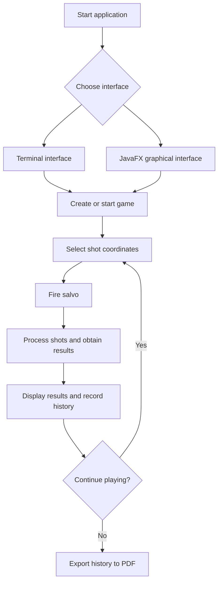

# ⚓ Battleship 2.0


> A Java implementation of the classic Battleship game, set in the age of the Portuguese Discoveries. Developed as a Software Engineering project at ISCTE-IUL, featuring a terminal interface, a JavaFX graphical interface, and PDF game-history export.

| Número | Nome | Curso |
|---:|---|---|
| 83590 | Valentyna Rusinova | Engenharia Informática (PL) |
| 105447 | Rodrigo Silva | Engenharia Informática (PL) |
| 128782 | João Mota | Engenharia Informática (PL) |
| 128791 | João Nunes | Engenharia Informática (PL) |

---

## 📖 Table of Contents

- [Project Overview](#-project-overview)
- [Key Features](#-key-features)
- [Student Contributions](#-student-contributions)
- [AI Opponent (LLM)](#-ai-opponent-llm)
- [Technical Stack](#-technical-stack)
- [Installation & Setup](#-installation--setup)
- [Code Architecture](#-code-architecture)
- [Roadmap](#-roadmap)
- [Contributing](#-contributing)
- [License](#-license)

---

## 🎯 Project Overview

Battleship 2.0 is a Java implementation of the classic naval warfare game, using ships associated with the Portuguese age of the Discoveries.

The project combines object-oriented programming, automated build management with Maven, a terminal user interface, a JavaFX graphical interface, and a REST server used for communication between the GUI and the game.

### 🎮 The Rules

The game is played on a 10 × 10 grid, with rows identified by letters A–J and columns numbered 1–10.

Each fleet consists of 11 ships:

- **4 Barges:** 1 grid position each.
- **3 Caravels:** 2 grid positions each.
- **2 Carracks:** 3 grid positions each.
- **1 Frigate:** 4 grid positions.
- **1 Galleon:** 5 grid positions arranged in a T shape.

Ships may be placed in different orientations, including the permitted orientations of the Galleon. They must not touch one another, even diagonally.

During the game, players fire salvos at selected coordinates. The game reports whether shots hit or miss, whether ships are sunk, and whether shots are invalid or repeated. The game ends when all ships in the target fleet have been sunk.

---

## ✨ Key Features

| Feature | Description | Status |
|---|---|:---:|
| **Grid System** | 10 × 10 board with labelled rows and numbered columns. | ✅ |
| **Ship Varieties** | Barges, Caravels, Carracks, Frigates and Galleons. | ✅ |
| **Terminal Interface (TUI)** | Generate fleets, inspect the board, fire salvos, view shots and simulate games through terminal commands. | ✅ |
| **Graphical Interface (GUI)** | JavaFX interface with two boards, interactive shot selection, game controls and results display. | ✅ |
| **Game Simulation** | Simulate a game using the terminal command `simula` or the corresponding GUI functionality. | ✅ |
| **PDF Game-History Export** | Export recorded moves, shot coordinates and outcomes to a PDF report. The TUI supports the `exportapdf` command; end-to-end GUI validation is pending. | 🚧 |
| **REST API** | Spring Boot server used for communication between the graphical client and the game. | ✅ |
| **AI Shot Strategy** | AI shot-selection functionality provided by the server-side strategy component. | ✅ |

---

## 👥 Student Contributions

The project has been extended through student-developed enhancements tracked with GitHub Issues.

### 1. Graphical Interface — [Issue #1](https://github.com/LEI-128791/Battleship2/issues/1)

The original game relied on terminal interaction. This enhancement introduced a JavaFX graphical interface to make playing and observing the game more intuitive.

The functionality includes:

- Visual representation of the player's and opponent's boards.
- Interactive selection of positions for firing shots.
- Display of shot results and the current game state.
- Game controls, including starting a new game, firing salvos and simulating gameplay.

The graphical interface communicates with the game server and presents the results of its responses without replacing the underlying game rules.

### 2. Export Game History to PDF — [Issue #3](https://github.com/LEI-128791/Battleship2/issues/3)

This enhancement allows players to save a game's move history as a PDF document for later review.

The implementation uses **Apache PDFBox**, a Java library for creating PDF documents.

The report includes:

- Sequential move numbers.
- Shot coordinates.
- The corresponding outcomes, such as water, a ship hit or a sunk ship.
- Multiple pages when the history is too long for one page.

The TUI provides the `exportapdf` command to generate the report. The exporter also selects a numbered filename when the requested filename already exists, helping prevent previous reports from being overwritten.

The graphical interface includes an export workflow with a file chooser; its end-to-end behaviour is still being validated.

The export functionality is implemented in a shared `PdfReportExporter` class, allowing both interfaces to reuse the same PDF-generation logic.

---

## 🤖 AI Opponent (LLM)

We trained an LLM (Gemini Pro) to play Battleship against our program using **few-shot prompting**. Shots and results are exchanged as JSON (copy & paste between the LLM and the console).

### Communication protocol

The `rajada` / `fire` command accepts a volley in the LLM's JSON format. It may span several lines, be pasted on the line after the command, or come inside a ```json code block, as chats usually return it:

```json
{
[ {"row": "A", "column": 5},
  {"row": "C", "column": 10},
  {"row": "F", "column" : 5} ]
}
```

The program answers with the JSON produced by `Move.processEnemyFire`. It always uses the protocol's keys and ship names, whatever the interface language:

```json
{
  "validShots" : 3,
  "sunkBoats" : [ { "count" : 1, "type" : "Barca" } ],
  "repeatedShots" : 0,
  "outsideShots" : 0,
  "hitsOnBoats" : [ { "hits" : 1, "type" : "Nau" } ],
  "missedShots" : 1
}
```

### Final strategy prompt

**Version 2.** With version 1 the LLM needed 31–34 volleys against our program (ChatGPT and Gemini games logged in `src/main/java/battleship/chatgpt1`, `chatgpt2`, `gemini1`, `gemini2`): it forgot old results, its 10x10 text map got corrupted, and it went back to searching while a hit ship was still afloat. Version 2 fixes this:

- The program now pastes the full **logbook** (every volley with its result) in each answer, so the LLM rebuilds its state from it instead of from memory.
- No more map: the LLM writes 4 short lists (FALTAM, AFUNDADOS, ALVOS ABERTOS, RAJADA).
- A fixed decision order: hunt (CAÇA), then test an ambiguous hit one candidate at a time (TESTE), and only then search (PROCURA).
- 4 complete few-shot examples of the hard cases, plus ready-made correction messages to paste when it makes a mistake.

A simulator that follows these rules exactly needs 22.8 volleys on average (80% of games between 20 and 25, 400 random fleets). The full rationale and the correction messages are in [PROMPT_ESTRATEGIA.md](PROMPT_ESTRATEGIA.md).

**Copy & paste tip:** after each `rajada`, the program prints a single line to paste into the chat: the JSON response, the logbook (every volley and its result), the list of every shot already fired (grouped by row) and a short reminder of the answer format. It only repeats what the LLM already received, so it gives away nothing about the fleet.

**All the messages to send to the LLM, in order** (rules, Galleon checks, protocol, strategy) are in [PROMPTS_GEMINI.md](PROMPTS_GEMINI.md).

```text
Considere agora a seguinte tática de geração de rajadas de tiros. Objetivo: afundar os 11 navios
inimigos (25 casas) no MENOR número de rajadas. Cada rajada tem SEMPRE 3 tiros.

========== MEMÓRIA: O DIÁRIO DE BORDO ==========
Cada resposta minha traz o JSON, o "Diário de Bordo" (todas as rajadas, com os 3 tiros e o resultado)
e os "Tiros já disparados". O Diário é a verdade: em cada jogada, reconstrua tudo a partir dele e
não da sua memória. A resposta diz o resultado da rajada em conjunto, NÃO diz qual tiro acertou.

========== NAVIOS ==========
Barca 1 · Caravela 2 (x3) · Nau 3 (x2) · Fragata 4 · Galeão 5 (x1). Barcas x4.
Caravela, Nau e Fragata são linhas retas (horizontal ou vertical). O Galeão é um T:
  Norte    Sul      Este     Oeste
  # # #    . # .    . . #    # . .
  . # .    . # .    # # #    # # #
  . # .    # # #    . . #    # . .
Os navios NUNCA se tocam, nem na diagonal: as 8 casas à volta de um navio são água.

========== FORMATO DE CADA RESPOSTA (sempre estas 4 partes) ==========
1) FALTAM: navios ainda a flutuar.
2) AFUNDADOS: cada navio afundado com as casas CERTAS dele (ex.: "Fragata F2 F3 F4 F5").
   Se não sabe as casas: "Barca (A3 ou A7 ou G5)".
3) ALVOS ABERTOS: cada navio atingido e ainda a flutuar, por exemplo:
   "Nau — certo: H8; mais 1 casa em H7, H9 ou G8"  ou  "Nau — 1 acerto em H8, E3 ou C9 (TESTE)".
   Se não houver nenhum, escreva "nenhum".
4) RAJADA: os 3 tiros, cada um com UMA razão curta ("H9 — caça Nau, Este de H8"). Depois:
   "Verificação: nenhum tiro está nos Tiros já disparados nem encostado a uma casa certa de AFUNDADOS."
   Por fim, estas 2 linhas com os mesmos 3 tiros (a 2.ª é o comando do jogo):
   { [ {"row": "H", "column": 9}, {"row": "E", "column": 4}, {"row": "C", "column": 8} ] }
   rajada H9 E4 C8

========== ORDEM DE DECISÃO (por esta ordem, sem exceções) ==========
1. CAÇA — há um ALVO com pelo menos uma casa CERTA? Os 3 tiros vão para ele.
2. TESTE — há um ALVO só com candidatos (acerto num de vários tiros)? Os 3 tiros testam um candidato.
3. PROCURA — só se não houver nenhum ALVO ABERTO.
Se a CAÇA ou o TESTE não dão 3 tiros úteis, complete com PROCURA longe do alvo (3 ou mais casas).
Nunca abandone um ALVO ABERTO para ir procurar: um acerto esquecido custa muitas rajadas.

========== CAÇA ==========
C1. Uma casa certa X: dispare nos vizinhos de X (Norte, Sul, Este, Oeste) que ainda estão livres.
    Nunca nas diagonais de X: são água (só o Galeão, por ser um T, foge a esta regra).
C2. Duas ou mais casas certas em linha: dispare só nessa linha, na casa seguinte de cada ponta
    (e na seguinte a essa, se sobrar um tiro). Nunca ao lado da linha.
C3. Um acerto num de vários vizinhos (ex.: "1 tiro na Nau" depois de H7 H9 G8 à volta de H8):
    o navio passa por X e por um deles. Dispare na casa seguinte em linha de cada hipótese
    (H6 para H7, H10 para H9, F8 para G8). Não precisa de saber qual foi: o "ao fundo" chega sozinho.
C4. Use o tamanho: um navio nunca tem mais acertos do que casas. Uma Nau com 2 acertos precisa de
    mais 1; quando a resposta disser "Nau ao fundo", pare de disparar nesse alvo.
C5. Galeão: se as casas certas não estão em linha, ou a linha já tem 3 e o navio não afundou,
    complete uma das 4 formas do T desenhadas acima.

========== TESTE (acerto ambíguo numa rajada de PROCURA) ==========
T1. Os candidatos são os tiros dessa rajada que não são água certa. Risque os que não podem ser esse
    navio: o tipo não cabe lá (falta espaço livre em linha para o tamanho dele) ou estão encostados
    a uma casa certa de um AFUNDADO.
T2. Teste o candidato com mais vizinhos livres: dispare 3 dos vizinhos dele (Norte, Sul, Este, Oeste).
T3. A resposta tem acerto nesse tipo de navio? Então o candidato era o navio: passa a CAÇA com
    "certo: <candidato>; mais 1 casa em <os 3 vizinhos>" (regra C3). Os outros candidatos dessa
    rajada de PROCURA eram água, se ela só teve 1 acerto.
    Não tem acerto? Esse candidato era (quase de certeza) água: risque-o e teste o seguinte.
    Se só sobrar 1 candidato, é certo: passa a CAÇA.

========== AFUNDADOS ==========
A1. "X ao fundo" e havia um ALVO ABERTO desse tipo: o navio afundado é esse alvo. Escreva em
    AFUNDADOS as casas que são certas. A partir daí nunca dispare nas 8 casas à volta delas.
A2. "Barca ao fundo" numa rajada de PROCURA: não sabe qual dos tiros foi. Escreva
    "Barca (A3 ou A7 ou G5)" e não dispare à volta. A Barca está acabada: não precisa de mais tiros.
A3. Uma rajada pode ter, ao mesmo tempo, um navio ao fundo e um acerto noutro navio. Trate cada um
    pela sua regra.

========== PROCURA ==========
Percorra a lista por ordem e use as primeiras casas que estejam livres. Salte casas já disparadas,
encostadas (mesmo na diagonal) a uma casa certa de navio, ou que sejam candidatos de um TESTE.
   Fase 1: H8 E3 C9 | I3 B10 F10 | C5 J2 I7 | A3 A7 G5 | B6 F2 G9 | D4 D8 H4 | J6 B2 F6 | E7 G1 C1 | J10
   Fase 2: I9 G3 A5 | H2 D10 B4 | E9 I1 A9 | C7 H6 H10 | D6 D2 I5 | E1 E5 A1 | G7 B8 C3 | F4 F8 J4 | J8
   Fase 3 (lista acabada ou só faltam Barcas): escolha casas livres que não toquem em nenhum navio,
   começando pelas zonas maiores sem tiros.
ÚLTIMA RAJADA: se faltarem menos de 3 casas onde ainda pode haver navio, complete os 3 tiros com
casas já disparadas (é a única exceção a "nunca repetir").

========== EXEMPLOS ==========
--- Exemplo A: acerto ambíguo na procura -> TESTE ---
Recebe: Diário de Bordo: [R1 H8 E3 C9 = 3 tiros válidos: 1 tiro num(a) Nau + 2 tiros na água]
Responde:
1) FALTAM: Galeão, Fragata, Nau x2, Caravela x3, Barca x4
2) AFUNDADOS: nenhum
3) ALVOS ABERTOS: Nau — 1 acerto em H8, E3 ou C9 (TESTE). Os 3 têm 4 vizinhos livres; testo H8.
4) RAJADA:
   H7 — teste de H8, Oeste
   H9 — teste de H8, Este
   G8 — teste de H8, Norte
   Verificação: nenhum tiro está nos Tiros já disparados nem encostado a uma casa certa de AFUNDADOS.
   { [ {"row": "H", "column": 7}, {"row": "H", "column": 9}, {"row": "G", "column": 8} ] }
   rajada H7 H9 G8

--- Exemplo B: o teste acerta -> CAÇA ---
Recebe: Diário de Bordo: [R1 H8 E3 C9 = 3 tiros válidos: 1 tiro num(a) Nau + 2 tiros na água;
R2 H7 H9 G8 = 3 tiros válidos: 1 tiro num(a) Nau + 2 tiros na água]
Responde:
1) FALTAM: Galeão, Fragata, Nau x2, Caravela x3, Barca x4
2) AFUNDADOS: nenhum
3) ALVOS ABERTOS: Nau — certo: H8; mais 1 casa em H7, H9 ou G8. (E3 e C9 eram água: a R1 só teve
   1 acerto.) Hipóteses da Nau (3 casas): H6 H7 H8, H8 H9 H10, F8 G8 H8 ou G8 H8 I8.
4) RAJADA:
   H6 — caça Nau, a seguir a H7
   H10 — caça Nau, a seguir a H9
   F8 — caça Nau, a seguir a G8
   Verificação: nenhum tiro está nos Tiros já disparados nem encostado a uma casa certa de AFUNDADOS.
   { [ {"row": "H", "column": 6}, {"row": "H", "column": 10}, {"row": "F", "column": 8} ] }
   rajada H6 H10 F8

--- Exemplo C: só 1 casa útil para a caça; o navio vai ao fundo -> AFUNDADOS e PROCURA ---
Antes: ALVOS ABERTOS: Fragata — certo: C5 C6 C7 (C4 já foi água). Só sobra uma ponta: C8.
Por isso a rajada foi C8 (caça) + I3 e B10 (procura, longe da Fragata).
Recebe: Diário de Bordo: [...; R6 C8 I3 B10 = 3 tiros válidos: 1 Fragata ao fundo + 2 tiros na água]
Responde:
1) FALTAM: Galeão, Nau x2, Caravela x3, Barca x4
2) AFUNDADOS: Fragata C5 C6 C7 C8 (a Fragata tem 4 casas; a única que faltava era C8, por isso
   I3 e B10 foram água)
3) ALVOS ABERTOS: nenhum
4) RAJADA: PROCURA. Salto C5 (é a Fragata) e qualquer casa encostada a C5 C6 C7 C8.
   F10 — procura, Fase 1
   J2 — procura, Fase 1
   I7 — procura, Fase 1
   Verificação: nenhum tiro está nos Tiros já disparados nem encostado a uma casa certa de AFUNDADOS.
   { [ {"row": "F", "column": 10}, {"row": "J", "column": 2}, {"row": "I", "column": 7} ] }
   rajada F10 J2 I7

--- Exemplo D: fim do jogo, só falta 1 Barca ---
Responde:
1) FALTAM: Barca x1
2) AFUNDADOS: (todos os outros, com as casas certas)
3) ALVOS ABERTOS: nenhum
4) RAJADA: PROCURA, Fase 3. Casas livres que não tocam em nenhum navio: B9, E1, J5 e J6.
   Escolho as 3 que estão mais longe de tudo.
   B9 — procura, só cabe Barca
   E1 — procura, só cabe Barca
   J5 — procura, só cabe Barca
   Verificação: nenhum tiro está nos Tiros já disparados nem encostado a uma casa certa de AFUNDADOS.
   { [ {"row": "B", "column": 9}, {"row": "E", "column": 1}, {"row": "J", "column": 5} ] }
   rajada B9 E1 J5

Se a sua frota for toda afundada, declare a derrota com honra. Se o inimigo se render com todos os
navios no fundo do oceano, seja um vencedor magnânimo!
```

> Few-shot examples used to teach the protocol, and the exact prompts used to set up the game, are in the assignment statement (Sprint – Parte 2).

---

## 🛠 Technical Stack

- **Language:** Java 21 or higher.
- **Build Tool:** Apache Maven.
- **Graphical Interface:** JavaFX.
- **Server:** Spring Boot and REST API.
- **PDF Generation:** Apache PDFBox.
- **JSON Processing:** Jackson.
- **Testing:** JUnit 5.
- **Logging:** Log4j2.
- **Version Control and Collaboration:** Git and GitHub.

Maven manages project dependencies, including the libraries required by the graphical interface, server and PDF exporter.

---

## 🚀 Installation & Setup

### Prerequisites

- JDK 21 or higher.
- Git.
- Apache Maven, or IntelliJ IDEA with its bundled Maven installation.

### Step-by-Step

**1. Clone the repository**

```bash
git clone https://github.com/LEI-128791/Battleship2.git
```

**2. Navigate to the Maven project**

```bash
cd Battleship2/Battleship2-main
```

**3. Compile the project and run the tests**

```bash
mvn test
```

**4. Run the terminal interface**

Open the project in IntelliJ IDEA and run the `main()` method in `battleship.Main`.

**5. Run the graphical interface**

Start the `main()` method in `restserver.BattleshipServer` and leave the server running. Then launch the JavaFX application using the Maven plugin:

```bash
mvn javafx:run
```

The graphical client uses the REST server to communicate with the game. Make sure the server is running before starting a GUI game.

---

## 🧱 Code Architecture

The project is organised into packages with different responsibilities.

### Core Components

| Component | Responsibility |
|---|---|
| `battleship` | Core game logic, ship and fleet management, positions, moves, and the terminal interface. |
| `gui` | JavaFX boards, graphical controls, the client-server communication layer and GUI event handling. |
| `restserver` | REST endpoints, game sessions, request/response data structures and AI shot strategy. |
| `PdfReportExporter` | Shared PDF generation logic using Apache PDFBox. |

The PDF exporter is separated from the user interfaces. The TUI and GUI can prepare the move history and pass it to the same exporter, avoiding duplicated PDF-generation code.

### Design Patterns and Design Principles

- **Separation of concerns:** the game rules, graphical presentation, server communication and PDF generation are handled by separate components.
- **Interface-based design:** the core game model uses interfaces such as `IGame` and `IMove`.
- **Callback-based interaction:** JavaFX controls invoke controller actions when users interact with the GUI.

### Logic Flow



---

## 📚 Documentation

The project includes Javadoc documentation in the [`docs/`](docs/) directory.

The documentation describes the project's classes, methods and interfaces, providing a reference for understanding and extending the implementation.

---

## 🗺 Roadmap

Potential future improvements include:

- [ ] Sound effects and additional game feedback.
- [ ] Further development of AI shot-selection strategies.
- [ ] Additional gameplay and multiplayer capabilities.

---

## 🧪 Testing

The project uses JUnit 5 to test the core game logic.

Run the test suite using Maven:

```bash
mvn test
```

Maven compiles the project, resolves the required dependencies and runs the configured tests.

---

## 🤝 Contributing

Contributions are developed using Git branches and tracked through GitHub Issues.

1. Identify or create an Issue describing the proposed enhancement.
2. Create a feature branch associated with that Issue.
3. Implement the change and commit it with a descriptive message referencing the Issue.
4. Run the appropriate checks.
5. Push the branch to GitHub.
6. Open a Pull Request referencing the corresponding Issue.
7. Ask another team member to review the changes before merging.

Example commit message:

```text
Refs #3: Improve PDF report generation
```

This workflow helps maintain traceability between requirements, implementation and review.

---

## 📄 License
Distributed under the MIT License. See `LICENSE` for more information.

---
**Maintained by:** [@britoeabreu](https://github.com/britoeabreu)  
*Created for the Software Engineering students at ISCTE-IUL.*
